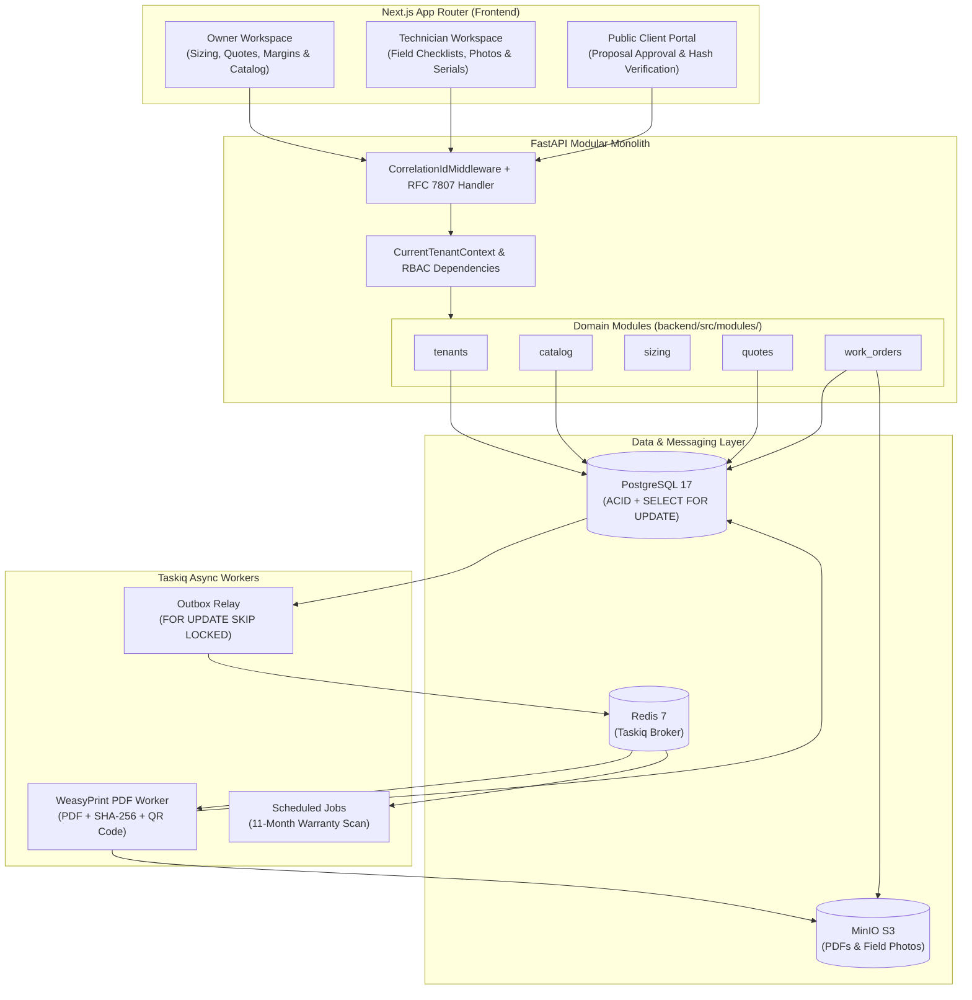

<div align="center">

# bravo-erp

**Multi-Tenant B2B Technical ERP for Electronic Security & CCTV Operations**

[](#quality-gate--testing)
[](https://www.python.org/)
[](https://fastapi.tiangolo.com/)
[](https://www.sqlalchemy.org/)
[](https://nextjs.org/)
[](https://www.typescriptlang.org/)
[](https://opensource.org/licenses/MIT)

[Overview](#overview) •
[System Architecture](#system-architecture) •
[Domain Engine](#domain-engine-cctv-sizing--topology) •
[Tech Stack](#tech-stack) •
[Getting Started](#getting-started) •
[Documentation](#documentation)

</div>

---

## Overview

`bravo-erp` is a multi-tenant B2B technical ERP built for electronic security and CCTV (CFTV) installation companies operating across hybrid analog (**Intelbras Multi-HD MHDX**) and IP (**Intelbras NVD / PoE**) ecosystems.

Field integrators routinely deal with undersized surveillance hard drives, incompatible hybrid DVR channel allocations, excessive voltage drops on long coaxial/UTP cable runs, and untracked equipment serial numbers during warranty claims. `bravo-erp` replaces manual spreadsheets with an automated engineering sizing engine, commercial quote management, mobile field work orders, and a hardware serial number and warranty tracker.

---

## System Architecture

### Modular Monolith Boundaries
The backend (`backend/src/modules/`) is organized into bounded contexts (`tenants`, `catalog`, `sizing`, `quotes`, `work_orders`, `tasks`). Cross-module mutations execute within a single SQLAlchemy `AsyncSession` Unit of Work to preserve ACID guarantees across tables, while asynchronous side effects (such as PDF rendering and background notifications) are dispatched through a transactional outbox. The engineering core (`sizing/domain/`) is written in pure Python with zero database or HTTP imports.

### Multi-Tenancy & Role-Based Field Redaction
- **Tenant Isolation:** Every tenant-scoped table is indexed with `organization_id` as the leading column. FastAPI injects a `CurrentTenantContext` dependency into service and repository calls, enforcing explicit `.where(Model.organization_id == ctx.organization_id)` filters across all queries ([ADR-002](./DECISIONS.md)).
- **Schema-Level Cost & Margin Redaction:** Field technicians (`TECHNICIAN`) and external clients (`PUBLIC_CLIENT`) must not have access to wholesale equipment costs (`cost_price_cents`) or profit margins (`margin_percent`). Rather than hiding fields only in the UI, the API uses separate Pydantic v2 response models (`QuoteOwnerResponse`, `QuoteTechnicianResponse`, `QuotePublicResponse`) that strip sensitive financial fields before serialization.

### Pessimistic Inventory Locking (`SELECT ... FOR UPDATE`)
When a customer approves a quote via its public link (`POST /api/v1/public/quotes/{public_token}/approve`), the system locks the required catalog rows inside an atomic transaction to prevent race conditions when two quotes compete for the last unit in stock.

To prevent PostgreSQL deadlocks when concurrent transactions lock overlapping items in different orders, target `catalog_item_id` UUIDs are sorted in ascending order prior to acquiring the row locks ([ADR-004](./DECISIONS.md)):

```python
sorted_item_ids: list[UUID] = sorted({item.catalog_item_id for item in physical_items})
stmt = (
    select(CatalogItem)
    .where(
        CatalogItem.organization_id == quote.organization_id,
        CatalogItem.id.in_(sorted_item_ids),
    )
    .order_by(CatalogItem.id.asc())
    .with_for_update()
)
```

### Transactional Outbox & Async PDF Pipeline
Domain state transitions (`Quote`, `CatalogItem`, `WorkOrder`, `AuditLog`) write an `OutboxEvent(status="PENDING")` record within the same database transaction ([ADR-005](./DECISIONS.md)). A Taskiq background worker polls `outbox_events` using `SELECT ... FOR UPDATE SKIP LOCKED`, renders the commercial proposal and warranty certificate into a PDF via **WeasyPrint**, computes its **SHA-256** integrity hash, embeds a verification **QR Code**, and uploads the document to **MinIO (S3)**.

### Error Handling & Observability
All domain and validation errors return **RFC 7807 (`application/problem+json`)** responses. Every HTTP request extracts or generates an `X-Correlation-ID` header, binds it to `structlog` context variables, and forwards it into `outbox_events` payloads so background workers log under the same request trace ID.



---

## Domain Engine: CCTV Sizing & Topology

The `sizing` module (`backend/src/modules/sizing/domain/`) computes hardware requirements from project parameters:

### 1. Surveillance Storage Calculation
For each camera group with stream bitrate (looked up by resolution `720p`–`4K`, FPS `15`/`20`/`30`, and codec `H.264`/`H.265`/`H.265+` Smart Codec), daily recording hours, and retention days:

```text
Daily Storage per Camera (GB) = (Bitrate_kbps * 3600 * Hours_per_day) / (8 * 1024 * 1024)
Total Required Storage (GB)   = Sum(Group_Cameras * Daily_Storage_GB * Retention_Days) * 1.15
```

*(Includes a 15% safety margin for filesystem and formatting overhead.)*

The engine evaluates available **WD Purple** surveillance drives (`1TB`, `2TB`, `4TB`, `8TB`) against the recorder's `max_sata_slots` and `max_tb_per_slot` limits, selecting the lowest-cost drive combination or upgrading the recorder to a multi-SATA model when required.

### 2. Intelbras MHDX Hybrid Channel Allocation
Intelbras Multi-HD DVRs (`4ch`, `8ch`, `16ch`, `32ch`) provide fixed physical BNC ports (`native_bnc_channels`), bonus IP channels (`extra_ip_channels`), and support **BNC-to-IP channel conversion** (converting unused analog BNC ports to accept IP streams). Given `N_analog` analog cameras and `N_ip` IP cameras:

```text
N_analog <= native_bnc_channels
Converted_Channels = native_bnc_channels - N_analog
N_ip <= extra_ip_channels + Converted_Channels
N_analog + N_ip <= native_bnc_channels + extra_ip_channels
```

For example, a topology with 7 analog BNC cameras and 3 IP cameras (10 cameras total) fits on an 8-channel **Intelbras MHDX 1108** (`8 BNC + 2 Extra IP`) by converting the 8th unused BNC port into an IP channel (`2 + 1 = 3 IP` capacity), avoiding an unnecessary upgrade to a 16-channel recorder.

### 3. Electrical Load, Voltage Drop & Auto-BOM
- **Power Supply & PoE Sizing:** Calculates total current draw with IR active plus a 30% safety margin (`I_total = Sum(I_cam_IR) * 1.30`) to select regulated 12V DC switching supplies (`5A`, `10A`, `20A`) or PoE switches (`802.3af/at` wattage budget with 25% headroom).
- **Copper Cable Voltage Drop:** Computes `Delta_V = 2 * Length_m * Current_A * Resistance_ohm_per_m` across coaxial bipolar (`20 AWG`) or Cat5e UTP (`24 AWG`). If voltage at the camera load drops below `10.8V DC` (exceeding a 10% drop on a 12V line), the engine returns a voltage drop warning.
- **Automatic Accessory BOM:** Derives passive video balun pairs (`XBP 502`), `P4` / `BNC` / `RJ45` connectors, `VBOX 1100E` junction boxes, cable rolls/boxes with a `1.15x` routing slack factor, and installation labor points.

---

## Tech Stack

| Category | Technologies |
| :--- | :--- |
| **Backend** | Python 3.12+, FastAPI, SQLAlchemy 2.0 (`AsyncSession`), Pydantic v2, Alembic |
| **Database & Queue** | PostgreSQL 17, Redis 7, Taskiq (`taskiq-redis`, `taskiq-fastapi`) |
| **Storage & Documents** | MinIO (S3-compatible), `aioboto3`, WeasyPrint, `qrcode[pil]`, Jinja2 |
| **Security & Logging** | `pyjwt`, `pwdlib[argon2]`, `structlog` (JSON logs + `X-Correlation-ID`), RFC 7807 |
| **Frontend** | Next.js (App Router), React 19, TypeScript 5 (`strict`), Tailwind CSS v4, `shadcn/ui` |
| **State & Forms** | TanStack Query v5, React Hook Form, Zod |
| **Quality & Testing** | Ruff, Mypy (`--strict`), Pytest, Testcontainers (PostgreSQL & Redis), ESLint |

---

## Getting Started

### Prerequisites
- Docker and Docker Compose v2.22+
- *(Optional for running host checks)*: `uv` (Python 3.12+) and `pnpm` (Node.js 22+)

### Run with Docker Compose Watch
```bash
git clone https://github.com/your-username/bravo-erp.git
cd bravo-erp
cp .env.example .env

docker compose -f docker-compose.dev.yml up --build --watch
```

The development stack uses native Linux bind mounts for `src/` directories alongside anonymous volumes for `.venv` and `node_modules` ([ADR-006](./DECISIONS.md)), providing instant hot-reload without colliding with host virtual environments.

### Demo Environment
On startup, the database seeder (`src/seed/demo_seeder.py`) populates a demo organization with an Intelbras/WD Purple/Condutti product catalog and sample quotes. The login screen at `http://localhost:3000/login` includes quick-switch buttons to sign in as an **Owner**, **Field Technician**, or **Public Client** without manual setup, as well as an option to reset the demo data at any time.

### Local Endpoints

| Service | URL | Notes |
| :--- | :--- | :--- |
| **Frontend Application** | `http://localhost:3000` | Next.js web interface |
| **Backend API & OpenAPI Docs** | `http://localhost:8000/api/v1/docs` | Swagger UI |
| **Healthcheck** | `http://localhost:8000/api/v1/health` | Service status and correlation header check |
| **MinIO Console** | `http://localhost:9001` | Default dev credentials in `.env.example` |

### Quality Gate & Testing
```bash
# Backend linting & formatting
uv run --project backend ruff check backend/src backend/tests backend/migrations
uv run --project backend ruff format --check backend/src backend/tests backend/migrations

# Backend strict static type checking
uv run --project backend mypy --config-file backend/pyproject.toml backend/src backend/tests --strict

# Backend unit & integration tests
uv run --project backend pytest backend/tests -v

# Frontend type checking & linting
pnpm -C frontend typecheck
pnpm -C frontend lint
```

---

## Documentation

Architectural specifications, domain formulas, and engineering decisions are maintained in the repository root:

- [`SPEC.md`](./SPEC.md) — Database schema (ERD), JSONB category specifications, sizing formulas, state machines, and REST API contracts.
- [`DECISIONS.md`](./DECISIONS.md) — Architecture Decision Records (ADRs 001–007).
- [`PLAN.md`](./PLAN.md) — Implementation roadmap and milestone tracker.
- [`AGENTS.md`](./AGENTS.md) — Development workflow, coding standards, and quality gate commands.

---

## Roadmap

- **DVR Heartbeat & S.M.A.R.T. Event Ingestion:** Parse automated alert emails/webhooks from Intelbras recorders (`Disk Error`, `Video Loss`) to open maintenance tickets automatically.
- **WhatsApp Notifications:** Send quote links, technician dispatch updates, and 11-month preventive maintenance reminders via WhatsApp webhooks.
- **Multi-Location Stock:** Track inventory across main warehouse shelves and individual technician vehicles.
- **Fiscal Invoicing:** Integrate Brazilian `NF-e` and `NFS-e` issuance upon work order completion.

---

## License

MIT License.
