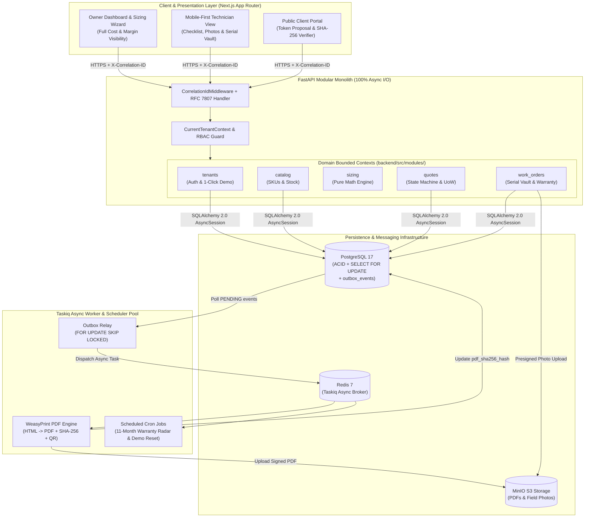

<div align="center">

# `bravo-erp`

### **Production-Grade Modular B2B SaaS & Technical ERP for Electronic Security & CCTV Operations (Intelbras / Hybrid Ecosystems)**

[](#7-zero-friction-quick-start-run-in-1-command)
[](https://www.python.org/)
[](https://fastapi.tiangolo.com/)
[](https://www.sqlalchemy.org/)
[](https://nextjs.org/)
[](https://www.typescriptlang.org/)
[](./docker-compose.dev.yml)
[](https://opensource.org/licenses/MIT)

[**Architecture Highlights**](#3-core-architectural-highlights-the-recruiter-hook) •
[**CCTV Sizing Math**](#4-domain-engine-deep-dive-cctv-sizing--intelbras-logic) •
[**Tech Stack**](#5-tech-stack--tooling-matrix) •
[**Quick Start**](#7-zero-friction-quick-start-run-in-1-command) •
[**Spec & ADRs**](#8-developer--agent-governance-spec-driven-engineering)

</div>

---

## 1. Executive Summary

**`bravo-erp`** is a multi-tenant B2B SaaS and Technical ERP purpose-built for **Electronic Security and CCTV (CFTV) Installation Companies** operating across hybrid analog (**Intelbras Multi-HD MHDX**) and IP (**Intelbras NVD / PoE**) hardware ecosystems.

This repository is engineered with two simultaneous goals:

1. **Real-World Field Operations:** Replaces error-prone spreadsheets in CCTV integration firms with a deterministic **CCTV Engineering & Sizing Engine** (computing surveillance HDD storage, hybrid BNC-to-IP channel allocation, 12V DC / PoE electrical loads, copper voltage drop, and automatic accessory Bill of Materials derivation), commercial proposal lifecycle management, mobile-first technician work orders, and a **Serial Number & Warranty Vault** with automated 11-month preventive maintenance upsell alerts.
2. **Mid-to-Senior / Staff Engineering Showcase:** Built to withstand deep architectural scrutiny during technical interviews. Rather than a basic CRUD wrapper, `bravo-erp` demonstrates **Modular Monolith** boundaries, 100% non-blocking async I/O (`FastAPI` + `SQLAlchemy 2.0 AsyncSession` + `Taskiq`), deadlock-free pessimistic database locking (`SELECT ... FOR UPDATE`), a **Transactional Outbox** (`outbox_events`), **RFC 7807 (`application/problem+json`)** error contracts, end-to-end `X-Correlation-ID` distributed tracing, and a **Zero-Friction 1-Click Recruiter Demo Mode**.

---

## 2. Core Architectural Highlights (The "Recruiter Hook")

### 🏛️ Modular Monolith with Pure Domain Isolation
The backend (`backend/src/modules/`) is partitioned into cohesive bounded contexts (`tenants`, `catalog`, `sizing`, `quotes`, `work_orders`, `tasks`). Cross-module state changes execute either inside a single explicit SQLAlchemy Unit of Work (preserving ACID invariants across tables without distributed 2PC overhead) or asynchronously via the Transactional Outbox. The engineering core (`sizing/domain/`) is **100% pure Python** with zero ORM or HTTP imports, enabling microsecond execution and 100% unit test branch coverage.

### 🔐 Explicit Multi-Tenancy & Schema-Level RBAC Cost Redaction
- **Explicit Tenant Context DI:** Every tenant-scoped table is prefixed with composite B-Tree indexes starting on `organization_id`. FastAPI injects an immutable `CurrentTenantContext` into every service and repository call, ensuring tenant isolation is explicit in query plans (`EXPLAIN ANALYZE`) and immune to connection-pool session bleed ([ADR-002](./DECISIONS.md#adr-002-application-level-multi-tenancy-via-explicit-organization_id--fastapi-currenttenantcontext-dependency-injection-over-postgresql-rls)).
- **Zero-Leakage RBAC Serialization:** Field technicians (`TECHNICIAN`) and external customers (`PUBLIC_CLIENT`) must never see equipment cost prices (`cost_price_cents`) or profit margins (`margin_percent`)—even if they inspect raw JSON payloads in browser DevTools. Instead of relying on frontend UI hiding, the backend enforces **role-segregated Pydantic v2 response schemas** (`QuoteOwnerResponse` vs. `QuoteTechnicianResponse` vs. `QuotePublicResponse`) that physically strip cost and margin attributes before serialization.

### 🔒 Concurrency-Safe Inventory Locking (Deadlock-Free `SELECT ... FOR UPDATE`)
When two customers simultaneously click **"Approve Proposal"** on public quotes competing for the last physical unit of an `Intelbras MHDX 3116` DVR in stock, naive read-then-write checks suffer from **TOCTOU (Time-of-Check to Time-of-Use)** race conditions.
- During `POST /api/v1/public/quotes/{public_token}/approve`, `bravo-erp` sorts all requested `catalog_item_id` UUIDs in **strict ascending order** before issuing `SELECT ... FOR UPDATE`:
  ```python
  sorted_item_ids: list[UUID] = sorted({item.catalog_item_id for item in physical_items})
  stmt = (
      select(CatalogItem)
      .where(
          CatalogItem.organization_id == quote.organization_id,
          CatalogItem.id.in_(sorted_item_ids),
      )
      .order_by(CatalogItem.id.asc())
      .with_for_update()
  )
  ```
- **Why sort UUIDs ascending?** Deterministic lock ordering guarantees a global Directed Acyclic Graph (DAG) of row lock acquisition across concurrent transactions, mathematically eliminating PostgreSQL deadlocks while serializing competing approvals ([ADR-004](./DECISIONS.md#adr-004-pessimistic-locking-select--for-update-with-deterministic-uuid-ordering-for-inventory-reservation-on-quote-approval)).

### 📬 Transactional Outbox Pattern (`outbox_events`)
To avoid holding database row locks during CPU-heavy PDF rendering and to prevent the **Dual-Write Problem** between PostgreSQL and Redis, domain mutations (`Quote`, `CatalogItem`, `WorkOrder`, `AuditLog`) insert an `OutboxEvent(status="PENDING")` row inside the **exact same ACID transaction** ([ADR-005](./DECISIONS.md#adr-005-transactional-outbox-pattern-outbox_events-for-reliable-async-side-effects-pdf-generation--work-order-notifications)). A Taskiq background relay polls `outbox_events` using `SELECT ... FOR UPDATE SKIP LOCKED` and dispatches downstream workers with at-least-once delivery guarantees.

### 📄 Async Cryptographic PDF Pipeline & RFC 7807 Observability
- **WeasyPrint + SHA-256 + QR Verification:** Taskiq workers asynchronously render Portuguese (`pt-BR`) Technical Proposals and Warranty Certificates into PDF via **WeasyPrint**, compute a cryptographic **SHA-256 hex digest** of the binary artifact, embed a verification **QR Code**, and upload to **MinIO (S3)**. Anyone scanning the QR code lands on `/public/verify/{sha256}` to verify document authenticity and hardware serial warranties.
- **RFC 7807 Problem Details & Correlation-ID:** Generic `HTTPException` calls are forbidden in domain/service layers. Typed `DomainError` exceptions map automatically to **RFC 7807 (`application/problem+json`)** responses carrying the request's `X-Correlation-ID`, which propagates from incoming HTTP headers into `structlog` JSON logs and `outbox_events` worker payloads.

---

## 3. System Architecture Diagram



---

## 4. Domain Engine Deep Dive (CCTV Sizing & Intelbras Logic)

The `sizing` module (`backend/src/modules/sizing/domain/`) implements deterministic engineering formulas tailored to real-world Brazilian CCTV installations:

### 1. Surveillance Storage Calculation (`H.264` / `H.265` / `H.265+` Smart Codec)
For each camera group with bitrate $\text{Bitrate}_{\text{kbps}}$ (resolved from our deterministic Resolution $\times$ FPS $\times$ Codec lookup table in [`SPEC.md`](./SPEC.md#31-storage-calculation-formula--bitrate-lookup-table)), daily recording hours $H \in [1, 24]$, and retention days $D$:

$$\text{GB}_{\text{day}} = \frac{\text{Bitrate (kbps)} \times 3600 \times H}{8 \times 1024 \times 1024}$$

$$\text{GB}_{\text{total}} = \left(\sum \text{GB}_{\text{day}} \times D\right) \times 1.15 \quad \text{(includes 15\% filesystem \& formatting safety margin)}$$

The engine evaluates all valid **Western Digital WD Purple** surveillance HDD combinations (`1TB`, `2TB`, `4TB`, `8TB`) against the DVR's physical `max_sata_slots` and `max_tb_per_slot`, selecting the most cost-effective combination or automatically upgrading to a multi-SATA recorder (`Intelbras MHDX 3116`).

### 2. Intelbras MHDX Hybrid Topology Validation
Intelbras Multi-HD DVRs (`4ch`, `8ch`, `16ch`, `32ch`) feature fixed physical BNC ports (`native_bnc_channels`), bonus native IP channels (`extra_ip_channels`), and **BNC-to-IP channel conversion** (sacrificing unused analog BNC ports to host IP cameras). Given $N_{\text{analog}}$ analog cameras and $N_{\text{ip}}$ IP cameras:

$$N_{\text{analog}} \le \text{native\_bnc\_channels}$$

$$C_{\text{converted}} = \text{native\_bnc\_channels} - N_{\text{analog}}$$

$$N_{\text{ip}} \le \text{extra\_ip\_channels} + C_{\text{converted}} \quad \text{and} \quad N_{\text{analog}} + N_{\text{ip}} \le \text{native\_bnc\_channels} + \text{extra\_ip\_channels}$$

> **Example:** A project with **7 Analog BNC cameras + 3 IP cameras** ($10$ total cameras) does **not** require an expensive 16-channel DVR. The engine proves that an 8-channel **Intelbras MHDX 1108** ($8\text{ BNC} + 2\text{ Extra IP}$) converts its $8\text{th}$ unused BNC port into an IP channel ($2 + 1 = 3\text{ IP}$ capacity, $10$ total channels) and selects the `MHDX 1108` automatically.

### 3. Electrical Sizing, Copper Voltage Drop & Auto-BOM Derivation
- **Current Draw with 30% Headroom:** $I_{\text{total}} = \left(\sum I_{\text{camera\_IR\_on}}\right) \times 1.30$, matching against regulated $12.8\text{V}$ switching power supplies (`5A`, `10A`, `20A` MCM Colmeia) or computing PoE wattage budgets ($1.25\times$ headroom) for Intelbras PoE Switches.
- **Copper Cable Voltage Drop Check:** Computes $\Delta V = 2 \times L \times I \times R_{\text{meter}}$ over coaxial bipolar ($20\text{ AWG}$) or Cat5e UTP ($24\text{ AWG}$). If voltage at the camera load drops below **$10.8\text{V DC}$** ($>10\%$ drop), the engine raises a structured `VoltageDropWarning` recommending parallel pair wiring or local PSU placement.
- **Automatic Accessory BOM:** Automatically derives passive video balun pairs (`Intelbras XBP 502`), `P4` / `BNC` / `RJ45` connectors, `VBOX 1100E` junction boxes, cable rolls/boxes with a **$1.15\times$ routing slack factor**, and per-point installation labor.

---

## 5. Tech Stack & Tooling Matrix

| Layer | Technology | Engineering Rationale |
| :--- | :--- | :--- |
| **Backend Framework** | **Python 3.12+**, **FastAPI** (`0.162+`), **Uvicorn** | 100% `async`/`await` I/O, PEP 695 generics, automatic OpenAPI 3.1 generation |
| **ORM & Database** | **PostgreSQL 17**, **SQLAlchemy 2.0 Async**, **Alembic** | Modern 2.0 `select()`/`Mapped[T]` syntax only, `asyncpg` driver, `SELECT ... FOR UPDATE` locking |
| **Validation & Settings** | **Pydantic v2**, `pydantic-settings` | Rust-backed serialization, discriminated JSONB `specs` unions, role-based field redaction |
| **Async Task Queue** | **Taskiq** (`taskiq-redis`, `taskiq-fastapi`), **Redis 7** | Native `asyncio` worker loop sharing FastAPI lifespan & `AsyncSession` without Celery event-loop hacks ([ADR-003](./DECISIONS.md#adr-003-taskiq-taskiq-redis-over-celery-for-native-asyncio-compatibility-with-fastapi-and-sqlalchemy-20)) |
| **PDF & Object Storage** | **WeasyPrint**, `qrcode[pil]`, **MinIO (S3)**, `aioboto3` | Async HTML-to-PDF rendering, SHA-256 document hashing, S3 presigned URLs |
| **Observability & Auth** | `structlog`, **RFC 7807**, `pyjwt`, `pwdlib[argon2]` | JSON structured logs with `X-Correlation-ID` propagation, Argon2id password hashing |
| **Frontend Stack** | **Next.js (App Router)**, **React 19**, **TypeScript 5 (Strict)** | Server/Client component split, `strict: true` + `noUncheckedIndexedAccess: true` |
| **UI & State Management** | **Tailwind CSS v4**, `shadcn/ui`, **TanStack Query v5**, **React Hook Form**, **Zod** | Accessible radix/base primitives, optimistic cache invalidation, schema-validated forms |
| **Quality Gate & Testing** | **Ruff**, **Mypy (`--strict`)**, **Pytest**, **Testcontainers**, **ESLint** | Zero `Any` tolerance, real PostgreSQL & Redis containers for concurrency integration tests |
| **Dev Containerization** | **Docker Compose Watch** (`docker-compose.dev.yml`) | Hybrid Linux bind mounts (`inotify` reload) + anonymous volume isolation for `.venv` & `node_modules` ([ADR-006](./DECISIONS.md#adr-006-hybrid-cachyos-linux-docker-compose-watch-strategy-bind-mounts-for-source--anonymous-volumes-for-venvnode_modules--lockfile-rebuild)) |

---

## 6. Zero-Friction Quick Start (Run in 1 Command)

### Prerequisites
- **Docker** & **Docker Compose v2.22+** (with Compose Watch support)
- *(Optional for host IDE/LSP)*: `uv` (Python 3.12+) and `pnpm` (Node.js 22 LTS)

### Step 1: Clone & Launch with Docker Compose Watch
```bash
git clone https://github.com/your-username/bravo-erp.git
cd bravo-erp
cp .env.example .env

# Starts Postgres 17, Redis 7, MinIO (+ bucket auto-setup), FastAPI Backend, Taskiq Worker, and Next.js Frontend
docker compose -f docker-compose.dev.yml up --build --watch
```

### Step 2: Explore via 1-Click Recruiter Demo Mode 🎯
Once the stack is healthy, open **`http://localhost:3000`**.
You do **not** need to register an account or type credentials:
1. Click **"Entrar como Proprietário (Demo Owner)"** to inspect full financial KPIs, equipment cost prices, profit margins, the interactive CCTV Sizing Wizard, and the **11-Month Preventive Maintenance Warranty Radar**.
2. Click **"Alternar para Visão Técnico (Demo Technician)"** to experience the mobile-first field Work Order checklist, MinIO installation photo upload, and **Serial Number Vault**—while verifying in your browser's Network tab that all cost and margin fields are stripped at the API boundary.
3. Click **"Abrir Link Público do Cliente (Demo Public Quote)"** to view a customer-facing proposal, download the WeasyPrint PDF, verify its SHA-256 QR authenticity hash, and trigger atomic `SELECT ... FOR UPDATE` inventory reservation in one click.
4. Click **"Restaurar Dados da Demo"** at any time to idempotently reset the demo tenant back to its initial Intelbras/WD Purple seed state.

### Local Service Endpoints

| Service | Local URL | Description |
| :--- | :--- | :--- |
| **Next.js Frontend App** | `http://localhost:3000` | Main ERP UI + 1-Click Recruiter Demo Mode |
| **FastAPI Interactive Docs (Swagger)** | `http://localhost:8000/api/v1/docs` | OpenAPI 3.1 specification & interactive REST tester |
| **Healthcheck & Correlation Probe** | `http://localhost:8000/api/v1/health` | Returns service health + `X-Correlation-ID` trace header |
| **MinIO S3 Web Console** | `http://localhost:9001` | Object storage browser (`minioadmin` / `minioadmin_secret`) |

### Running the Strict Quality Gate Suite
```bash
# 1. Backend Linter & Formatter (Ruff)
uv run --project backend ruff check backend/src backend/tests backend/migrations
uv run --project backend ruff format --check backend/src backend/tests backend/migrations

# 2. Backend Static Type Checker (Mypy --strict, zero Any)
uv run --project backend mypy --config-file backend/pyproject.toml backend/src backend/tests --strict

# 3. Backend Unit & Concurrency Integration Tests (Pytest + Testcontainers)
uv run --project backend pytest backend/tests -v

# 4. Frontend Strict TypeScript & ESLint
pnpm -C frontend typecheck
pnpm -C frontend lint
```

---

## 7. Developer & Agent Governance (Spec-Driven Engineering)

This repository practices **Spec-Driven AI Development**. Every architectural invariant, database constraint, mathematical formula, and task transition is governed by four living documents at the repository root:

- **[`AGENTS.md`](./AGENTS.md):** The supreme operational constitution for AI coding agents and contributors. Enforces the 4-step Golden Protocol (*Context Ingestion → Scope Change Capture → CLI-First Execution → Strict Quality Gate*).
- **[`SPEC.md`](./SPEC.md):** Complete engineering specification containing the 10-table Mermaid ERD, category-specific `specs` JSONB schemas, CCTV sizing formulas, state machines, and REST API contracts.
- **[`DECISIONS.md`](./DECISIONS.md):** Formal Architecture Decision Records (**ADR-001** through **ADR-007**) documenting the *why* and *trade-offs* behind every major technical choice (e.g., Modular Monolith, Explicit Tenant DI vs. RLS, Taskiq vs. Celery, Pessimistic Locking, Transactional Outbox, Integer `_cents` arithmetic).
- **[`PLAN.md`](./PLAN.md):** Granular, phased execution tracker with verifiable quality gates per milestone.

---

## 8. Future Roadmap (v2 Horizons)

- [ ] **Real-Time DVR Heartbeat & HDD S.M.A.R.T. Ingestion (SMTP/Webhook Collector):** Ingest automated email/webhook alerts emitted by Intelbras MHDX/NVD recorders (`Disk Error`, `Video Loss`, `Fan Failure`) to automatically open high-priority maintenance Work Orders.
- [ ] **Automated WhatsApp Cloud API Notifications:** Dispatch quote approval links, technician en-route notifications, and 11-month preventive maintenance proposals directly to the customer's WhatsApp via Taskiq outbox consumers.
- [ ] **Multi-Van / Multi-Warehouse Inventory Transfers:** Track stock across central warehouse shelves and individual technician service vehicles (`van_stock_locations`).
- [ ] **Fiscal Invoice Integration (NF-e / NFS-e):** Emit Brazilian product (`NF-e`) and installation service (`NFS-e`) tax invoices automatically upon Work Order completion.

---

## License

Distributed under the **MIT License**. Built with precision as both a real-world CCTV engineering platform and a reference architecture for modern asynchronous Python & TypeScript systems.
