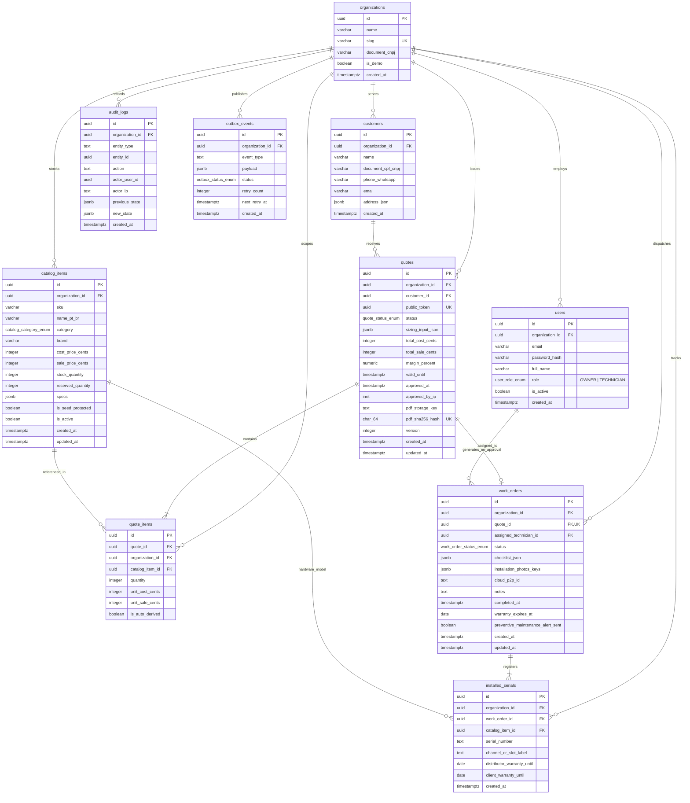
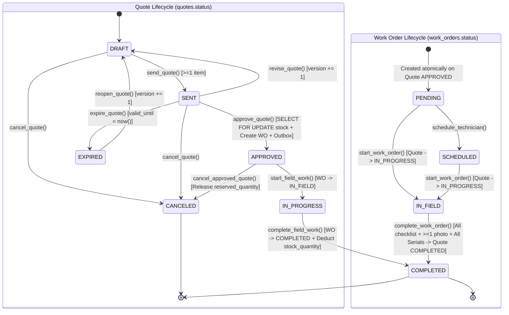

# `SPEC.md` — Deep Functional & Technical Specification

> **Document Purpose:** Definitive engineering specification for `bravo-erp`. All database schemas, JSONB contracts, CCTV engineering formulas, state machines, concurrency algorithms, and REST API endpoints implemented in the codebase MUST conform strictly to this specification.

---

## 1. System Architecture & Monorepo Layout

`bravo-erp` is structured as a single-repository **Modular Monolith** on the backend paired with a Next.js App Router frontend. Each backend domain module inside `backend/src/modules/` owns its models, Pydantic schemas, repository queries, domain logic, and FastAPI routers, communicating across boundaries strictly via service interfaces or the transactional outbox (`outbox_events`).

```text
bravo-erp/
├── AGENTS.md                           # AI Agent operational constitution & workflow loop
├── SPEC.md                             # Deep functional & technical specification (this file)
├── DECISIONS.md                        # Architecture Decision Records (ADRs 001–007)
├── PLAN.md                             # Living phased execution roadmap & task tracker
├── README.md                           # Recruiter showcase, architecture overview, 1-command start
├── .gitignore                          # Unified Python, Node, Docker, and OS ignore rules
├── .env.example                        # Deterministic local/dev environment variable template
├── docker-compose.dev.yml              # CachyOS Linux hybrid Docker Compose Watch configuration
│
├── backend/
│   ├── Dockerfile.dev                  # Python 3.12 + uv + WeasyPrint system libraries
│   ├── pyproject.toml                  # Dependencies + strict ruff, mypy, and pytest config
│   ├── uv.lock                         # Deterministic Python lockfile
│   ├── alembic.ini                     # Async Alembic configuration
│   ├── migrations/
│   │   ├── env.py                      # Async SQLAlchemy metadata migration runner
│   │   └── versions/                   # Atomic schema revision scripts
│   ├── src/
│   │   ├── __init__.py
│   │   ├── main.py                     # FastAPI application factory, lifespan, middleware, routers
│   │   ├── worker.py                   # Taskiq worker entrypoint importing broker and tasks
│   │   ├── core/
│   │   │   ├── __init__.py
│   │   │   ├── config.py               # Pydantic BaseSettings environment configuration
│   │   │   ├── database.py             # AsyncEngine, async_sessionmaker, DeclarativeBase
│   │   │   ├── broker.py               # Taskiq Redis broker & scheduler hooked via taskiq-fastapi
│   │   │   ├── security.py             # Argon2 password hashing, JWT creation/verification
│   │   │   ├── dependencies.py         # CurrentTenantContext, RequireRole FastAPI dependencies
│   │   │   ├── exceptions.py           # DomainError hierarchy + RFC 7807 Problem+JSON handler
│   │   │   ├── logging.py              # structlog JSON setup + Correlation-ID middleware
│   │   │   └── storage.py              # Async S3/MinIO client wrapper (upload, presigned URLs)
│   │   ├── modules/
│   │   │   ├── tenants/                # Multi-tenancy, users, RBAC, 1-Click Recruiter Demo
│   │   │   │   ├── models.py           # Organization, User
│   │   │   │   ├── schemas.py          # Auth tokens, Demo login, User/Org DTOs
│   │   │   │   ├── repository.py       # Tenant & User queries
│   │   │   │   ├── service.py          # Auth & Demo login/reset orchestration
│   │   │   │   └── router.py           # /api/v1/auth/*
│   │   │   ├── catalog/                # Equipment Catalog & Stock Management
│   │   │   │   ├── models.py           # CatalogItem
│   │   │   │   ├── schemas.py          # Category JSONB specs + Owner vs Technician DTOs
│   │   │   │   ├── repository.py       # Includes deterministic SELECT ... FOR UPDATE locking
│   │   │   │   ├── service.py          # Catalog CRUD, Demo seed protection, stock adjustments
│   │   │   │   └── router.py           # /api/v1/catalog/*
│   │   │   ├── sizing/                 # CCTV Engineering & Sizing Engine
│   │   │   │   ├── domain/             # Pure Python domain engine (zero DB/HTTP imports)
│   │   │   │   │   ├── value_objects.py# Frozen dataclasses for inputs/outputs
│   │   │   │   │   ├── bitrate_table.py# Deterministic H.264/H.265/H.265+ lookup table
│   │   │   │   │   ├── strategies.py   # Storage, MHDX Hybrid Topology, Electrical & Voltage Drop
│   │   │   │   │   └── engine.py       # CCTVSizingEngine orchestrator
│   │   │   │   ├── schemas.py          # Sizing request/response Pydantic v2 schemas
│   │   │   │   ├── service.py          # Maps pure domain output to live tenant CatalogItem SKUs
│   │   │   │   └── router.py           # /api/v1/sizing/*
│   │   │   ├── quotes/                 # Commercial Proposals, State Machine & Public Approval
│   │   │   │   ├── models.py           # Customer, Quote, QuoteItem, AuditLog, OutboxEvent
│   │   │   │   ├── state_machine.py    # QuoteStateMachine transitions, guards, and diff builder
│   │   │   │   ├── schemas.py          # QuoteOwnerResponse, QuoteTechnicianResponse, QuotePublicResponse
│   │   │   │   ├── repository.py       # Quote, Customer, AuditLog, and OutboxEvent persistence
│   │   │   │   ├── service.py          # Quote lifecycle & atomic Pessimistic Lock Approval UoW
│   │   │   │   └── router.py           # /api/v1/quotes/*, /api/v1/customers/*, /api/v1/public/quotes/*
│   │   │   ├── work_orders/            # Field Execution, Serial Vault & Warranty Tracking
│   │   │   │   ├── models.py           # WorkOrder, InstalledSerial
│   │   │   │   ├── state_machine.py    # WorkOrderStateMachine & completion guards
│   │   │   │   ├── schemas.py          # Checklist, Photo upload, and Serial Vault DTOs
│   │   │   │   ├── repository.py       # WorkOrder, InstalledSerial, and 11-month warranty queries
│   │   │   │   ├── service.py          # Technician field execution & warranty verification
│   │   │   │   └── router.py           # /api/v1/work-orders/*, /api/v1/verify/*
│   │   │   └── tasks/                  # Async Background Workers & Scheduled Jobs (Taskiq)
│   │   │       ├── outbox_relay.py     # Polls outbox_events and dispatches Taskiq tasks
│   │   │       ├── pdf_generator.py    # WeasyPrint HTML->PDF + SHA-256 + QR Code + MinIO upload
│   │   │       ├── warranty_cron.py    # 11-month preventive maintenance alert scanner
│   │   │       ├── demo_reset_cron.py  # Periodic Demo Tenant state restoration
│   │   │       └── templates/          # Jinja2 PT-BR Technical Proposal & Warranty PDF template
│   │   └── seed/
│   │       └── demo_seeder.py          # Idempotent PT-BR Intelbras/WD Purple/Condutti seed script
│   └── tests/
│       ├── conftest.py                 # Testcontainers (Postgres + Redis) & async session fixtures
│       ├── unit/
│       │   ├── test_sizing_engine.py   # 100% branch coverage of storage, MHDX, power, voltage drop
│       │   ├── test_state_machines.py  # Quote and WorkOrder state transition tests
│       │   └── test_rbac_schemas.py    # Verifies TECHNICIAN/PUBLIC schemas strip cost/margin fields
│       └── integration/
│           ├── test_tenant_isolation.py# Cross-tenant data isolation & 404/403 enforcement
│           ├── test_quote_concurrency.py# asyncio.gather parallel quote approval vs last stock unit
│           └── test_outbox_and_pdf.py  # Outbox -> Taskiq -> WeasyPrint PDF + SHA-256 verification
│
└── frontend/
    ├── Dockerfile.dev                  # Node LTS + pnpm development container
    ├── package.json
    ├── pnpm-lock.yaml
    ├── tsconfig.json
    ├── next.config.ts
    └── src/
        ├── app/
        │   ├── (auth)/login/           # Login + 1-Click Recruiter Demo Mode buttons
        │   ├── (dashboard)/            # Authenticated shell with role-switcher banner
        │   │   ├── dashboard/          # KPIs, 11-month warranty radar, active quotes/work orders
        │   │   ├── sizing/             # Interactive CCTV Sizing Wizard
        │   │   ├── catalog/            # Equipment Catalog & Inventory (Owner sees cost/margin)
        │   │   ├── quotes/             # Quote management, state transitions, audit logs
        │   │   └── work-orders/        # Mobile-first technician view, checklist, photos, S/N vault
        │   └── public/
        │       ├── quotes/[token]/     # Client Proposal Acceptance Portal (no login required)
        │       └── verify/[sha256]/    # Public SHA-256 PDF & Warranty authenticity verifier
        ├── components/
        │   ├── ui/                     # CLI-generated shadcn/ui primitives
        │   ├── layout/                 # Sidebar, Topbar, Demo Role Switcher
        │   ├── sizing/                 # Camera group cards, MHDX topology badge, BOM preview
        │   ├── quotes/                 # Quote table, status timeline, public approval dialog
        │   └── work-orders/            # Checklist toggles, photo uploader, Serial Vault form
        ├── hooks/                      # TanStack Query hooks
        ├── lib/                        # Typed API client (RFC 7807 parser), auth store, Zod schemas
        └── types/                      # Strict TypeScript interfaces matching backend schemas
```

---

## 2. Complete Database Schema & Entity-Relationship Diagram (ERD)

### 2.1. Mermaid Entity-Relationship Diagram



### 2.2. Detailed Table Definitions, Constraints & Composite Indexes

#### 1. `organizations`
| Column | SQL Type | Nullable | Default | Constraints / Notes |
| :--- | :--- | :--- | :--- | :--- |
| `id` | `UUID` | `NOT NULL` | `uuidv7()` | Primary Key |
| `name` | `VARCHAR(160)` | `NOT NULL` | — | Company trade name (e.g., `"Bravo Segurança Eletrônica Ltda"`) |
| `slug` | `VARCHAR(80)` | `NOT NULL` | — | `UNIQUE` (`uq_organizations_slug`) |
| `document_cnpj` | `VARCHAR(18)` | `NOT NULL` | — | Brazilian CNPJ identifier |
| `is_demo` | `BOOLEAN` | `NOT NULL` | `false` | Marks the Recruiter Demo Tenant |
| `created_at` | `TIMESTAMPTZ` | `NOT NULL` | `now()` | UTC creation timestamp |

#### 2. `users`
| Column | SQL Type | Nullable | Default | Constraints / Notes |
| :--- | :--- | :--- | :--- | :--- |
| `id` | `UUID` | `NOT NULL` | `uuidv7()` | Primary Key |
| `organization_id` | `UUID` | `NOT NULL` | — | `FK -> organizations.id ON DELETE CASCADE` |
| `email` | `VARCHAR(255)` | `NOT NULL` | — | Unique per tenant (`uq_users_org_email`) |
| `password_hash` | `TEXT` | `NOT NULL` | — | Argon2id password hash |
| `full_name` | `VARCHAR(160)` | `NOT NULL` | — | Full display name |
| `role` | `ENUM('OWNER', 'TECHNICIAN')` | `NOT NULL` | — | RBAC Role (`user_role_enum`) |
| `is_active` | `BOOLEAN` | `NOT NULL` | `true` | Soft disable flag |
| `created_at` | `TIMESTAMPTZ` | `NOT NULL` | `now()` | UTC creation timestamp |
- **Indexes:** `ix_users_organization_id` (`organization_id`), `uq_users_org_email` (`organization_id`, `email` UNIQUE).

#### 3. `catalog_items`
| Column | SQL Type | Nullable | Default | Constraints / Notes |
| :--- | :--- | :--- | :--- | :--- |
| `id` | `UUID` | `NOT NULL` | `uuidv7()` | Primary Key |
| `organization_id` | `UUID` | `NOT NULL` | — | `FK -> organizations.id ON DELETE CASCADE` |
| `sku` | `VARCHAR(64)` | `NOT NULL` | — | Manufacturer or internal SKU (e.g., `"MHDX-1108"`) |
| `name_pt_br` | `VARCHAR(255)` | `NOT NULL` | — | Commercial product title in PT-BR |
| `category` | `ENUM` | `NOT NULL` | — | `DVR`, `CAMERA_ANALOG`, `CAMERA_IP`, `HDD`, `POWER_SUPPLY`, `POE_SWITCH`, `CABLE`, `BALUN`, `CONNECTOR`, `ACCESSORY`, `SERVICE_LABOR` |
| `brand` | `VARCHAR(80)` | `NOT NULL` | — | e.g., `"Intelbras"`, `"Western Digital"`, `"MCM"`, `"Condutti"` |
| `cost_price_cents` | `INTEGER` | `NOT NULL` | — | `CHECK (cost_price_cents >= 0)` — **Hidden from `TECHNICIAN` & `PUBLIC_CLIENT`** |
| `sale_price_cents` | `INTEGER` | `NOT NULL` | — | `CHECK (sale_price_cents >= 0)` |
| `stock_quantity` | `INTEGER` | `NOT NULL` | `0` | Physical inventory on hand (`CHECK (stock_quantity >= 0)`) |
| `reserved_quantity` | `INTEGER` | `NOT NULL` | `0` | Locked by `APPROVED`/`IN_PROGRESS` quotes (`CHECK (reserved_quantity >= 0 AND stock_quantity - reserved_quantity >= 0)`) |
| `specs` | `JSONB` | `NOT NULL` | `'{}'::jsonb` | Validated by category-specific Pydantic v2 schemas (Section 2.3) |
| `is_seed_protected` | `BOOLEAN` | `NOT NULL` | `false` | Prevents destructive deletion of base demo SKUs |
| `is_active` | `BOOLEAN` | `NOT NULL` | `true` | Active in sizing engine & quote builder |
| `created_at` | `TIMESTAMPTZ` | `NOT NULL` | `now()` | — |
| `updated_at` | `TIMESTAMPTZ` | `NOT NULL` | `now()` | — |
- **Indexes:** `uq_catalog_items_org_sku` (`organization_id`, `sku` UNIQUE), `ix_catalog_items_org_category` (`organization_id`, `category`, `is_active`).

#### 4. `customers`
| Column | SQL Type | Nullable | Default | Constraints / Notes |
| :--- | :--- | :--- | :--- | :--- |
| `id` | `UUID` | `NOT NULL` | `uuidv7()` | Primary Key |
| `organization_id` | `UUID` | `NOT NULL` | — | `FK -> organizations.id ON DELETE CASCADE` |
| `name` | `VARCHAR(200)` | `NOT NULL` | — | Client name or Condominium/Company title |
| `document_cpf_cnpj` | `VARCHAR(20)` | `NOT NULL` | — | CPF or CNPJ |
| `phone_whatsapp` | `VARCHAR(30)` | `NOT NULL` | — | E.164 or Brazilian formatted phone |
| `email` | `VARCHAR(255)` | `NOT NULL` | — | Contact email |
| `address_json` | `JSONB` | `NOT NULL` | — | `{street, number, complement, district, city, state, zip_code}` |
| `created_at` | `TIMESTAMPTZ` | `NOT NULL` | `now()` | — |
- **Indexes:** `ix_customers_org_doc` (`organization_id`, `document_cpf_cnpj`).

#### 5. `quotes`
| Column | SQL Type | Nullable | Default | Constraints / Notes |
| :--- | :--- | :--- | :--- | :--- |
| `id` | `UUID` | `NOT NULL` | `uuidv7()` | Primary Key |
| `organization_id` | `UUID` | `NOT NULL` | — | `FK -> organizations.id ON DELETE CASCADE` |
| `customer_id` | `UUID` | `NOT NULL` | — | `FK -> customers.id ON DELETE RESTRICT` |
| `public_token` | `UUID` | `NOT NULL` | `uuidv4()` | `UNIQUE` indexed token for `PUBLIC_CLIENT` access |
| `status` | `ENUM` | `NOT NULL` | `'DRAFT'` | `DRAFT`, `SENT`, `APPROVED`, `IN_PROGRESS`, `COMPLETED`, `CANCELED`, `EXPIRED` |
| `sizing_input_json` | `JSONB` | `Nullable` | `NULL` | Immutable snapshot of the CCTV Sizing Engine inputs & computed metrics |
| `total_cost_cents` | `INTEGER` | `NOT NULL` | `0` | Sum of `quantity * unit_cost_cents` (**Hidden from `TECHNICIAN` & `PUBLIC_CLIENT`**) |
| `total_sale_cents` | `INTEGER` | `NOT NULL` | `0` | Sum of `quantity * unit_sale_cents` |
| `margin_percent` | `NUMERIC(6,2)` | `NOT NULL` | `0.00` | `((total_sale_cents - total_cost_cents) / total_sale_cents) * 100` (**Hidden from `TECHNICIAN` & `PUBLIC_CLIENT`**) |
| `valid_until` | `TIMESTAMPTZ` | `NOT NULL` | — | Proposal expiration timestamp |
| `approved_at` | `TIMESTAMPTZ` | `Nullable` | `NULL` | Timestamp of client approval |
| `approved_by_ip` | `INET` | `Nullable` | `NULL` | Client IP captured on approval |
| `pdf_storage_key` | `TEXT` | `Nullable` | `NULL` | MinIO object key (e.g., `proposals/{org_id}/{quote_id}.pdf`) |
| `pdf_sha256_hash` | `CHAR(64)` | `Nullable` | `NULL` | `UNIQUE` hex SHA-256 digest of generated PDF |
| `version` | `INTEGER` | `NOT NULL` | `1` | Optimistic version counter incremented on revision/transition |
| `created_at` | `TIMESTAMPTZ` | `NOT NULL` | `now()` | — |
| `updated_at` | `TIMESTAMPTZ` | `NOT NULL` | `now()` | — |
- **Indexes:** `uq_quotes_public_token` (`public_token` UNIQUE), `uq_quotes_pdf_sha256_hash` (`pdf_sha256_hash` UNIQUE), `ix_quotes_org_status_created` (`organization_id`, `status`, `created_at DESC`).

#### 6. `quote_items`
| Column | SQL Type | Nullable | Default | Constraints / Notes |
| :--- | :--- | :--- | :--- | :--- |
| `id` | `UUID` | `NOT NULL` | `uuidv7()` | Primary Key |
| `quote_id` | `UUID` | `NOT NULL` | — | `FK -> quotes.id ON DELETE CASCADE` |
| `organization_id` | `UUID` | `NOT NULL` | — | `FK -> organizations.id ON DELETE CASCADE` |
| `catalog_item_id` | `UUID` | `NOT NULL` | — | `FK -> catalog_items.id ON DELETE RESTRICT` |
| `quantity` | `INTEGER` | `NOT NULL` | — | `CHECK (quantity > 0)` |
| `unit_cost_cents` | `INTEGER` | `NOT NULL` | — | Snapshot of cost at quote creation (**Hidden from `TECHNICIAN` & `PUBLIC_CLIENT`**) |
| `unit_sale_cents` | `INTEGER` | `NOT NULL` | — | Snapshot of sale price at quote creation |
| `is_auto_derived` | `BOOLEAN` | `NOT NULL` | `false` | `true` if derived automatically by the CCTV Sizing Engine |
- **Indexes:** `ix_quote_items_quote_id` (`quote_id`), `ix_quote_items_org_catalog` (`organization_id`, `catalog_item_id`).

#### 7. `work_orders`
| Column | SQL Type | Nullable | Default | Constraints / Notes |
| :--- | :--- | :--- | :--- | :--- |
| `id` | `UUID` | `NOT NULL` | `uuidv7()` | Primary Key |
| `organization_id` | `UUID` | `NOT NULL` | — | `FK -> organizations.id ON DELETE CASCADE` |
| `quote_id` | `UUID` | `NOT NULL` | — | `UNIQUE FK -> quotes.id ON DELETE RESTRICT` |
| `assigned_technician_id` | `UUID` | `Nullable` | `NULL` | `FK -> users.id ON DELETE SET NULL` |
| `status` | `ENUM` | `NOT NULL` | `'PENDING'` | `PENDING`, `SCHEDULED`, `IN_FIELD`, `COMPLETED` |
| `checklist_json` | `JSONB` | `NOT NULL` | `'[]'::jsonb` | Array of `{step_id, label_pt_br, is_checked, checked_at}` |
| `installation_photos_keys` | `JSONB` | `NOT NULL` | `'[]'::jsonb` | Array of MinIO object keys (`string[]`) |
| `cloud_p2p_id` | `TEXT` | `Nullable` | `NULL` | Intelbras Cloud / Sim Next QR Code ID |
| `notes` | `TEXT` | `Nullable` | `NULL` | Technician field observations |
| `completed_at` | `TIMESTAMPTZ` | `Nullable` | `NULL` | UTC timestamp when marked `COMPLETED` |
| `warranty_expires_at` | `DATE` | `Nullable` | `NULL` | `completed_at::date + INTERVAL '12 months'` |
| `preventive_maintenance_alert_sent` | `BOOLEAN` | `NOT NULL` | `false` | Flagged `true` by the 11-month Taskiq cron job |
| `created_at` | `TIMESTAMPTZ` | `NOT NULL` | `now()` | — |
| `updated_at` | `TIMESTAMPTZ` | `NOT NULL` | `now()` | — |
- **Indexes:** `uq_work_orders_quote_id` (`quote_id` UNIQUE), `ix_work_orders_org_status` (`organization_id`, `status`), `ix_work_orders_warranty_scan` (`organization_id`, `warranty_expires_at`, `preventive_maintenance_alert_sent`).

#### 8. `installed_serials`
| Column | SQL Type | Nullable | Default | Constraints / Notes |
| :--- | :--- | :--- | :--- | :--- |
| `id` | `UUID` | `NOT NULL` | `uuidv7()` | Primary Key |
| `organization_id` | `UUID` | `NOT NULL` | — | `FK -> organizations.id ON DELETE CASCADE` |
| `work_order_id` | `UUID` | `NOT NULL` | — | `FK -> work_orders.id ON DELETE CASCADE` |
| `catalog_item_id` | `UUID` | `NOT NULL` | — | `FK -> catalog_items.id ON DELETE RESTRICT` |
| `serial_number` | `TEXT` | `NOT NULL` | — | Hardware S/N (e.g., Intelbras DVR/Camera S/N or WD Purple S/N) |
| `channel_or_slot_label` | `TEXT` | `NOT NULL` | — | e.g., `"BNC-01 (Portaria)"`, `"SATA-01"`, `"RACK-DVR-01"` |
| `distributor_warranty_until` | `DATE` | `NOT NULL` | — | Manufacturer/Distributor warranty expiration (e.g., +12m or +36m) |
| `client_warranty_until` | `DATE` | `NOT NULL` | — | Installation warranty expiration provided to the client (+12m) |
| `created_at` | `TIMESTAMPTZ` | `NOT NULL` | `now()` | — |
- **Indexes:** `ix_installed_serials_org_sn` (`organization_id`, `serial_number`), `ix_installed_serials_work_order` (`work_order_id`).

#### 9. `audit_logs`
| Column | SQL Type | Nullable | Default | Constraints / Notes |
| :--- | :--- | :--- | :--- | :--- |
| `id` | `UUID` | `NOT NULL` | `uuidv7()` | Primary Key |
| `organization_id` | `UUID` | `NOT NULL` | — | `FK -> organizations.id ON DELETE CASCADE` |
| `entity_type` | `TEXT` | `NOT NULL` | — | `"QUOTE"`, `"WORK_ORDER"`, `"CATALOG_ITEM"` |
| `entity_id` | `UUID` | `NOT NULL` | — | Primary key of the mutated entity |
| `action` | `TEXT` | `NOT NULL` | — | e.g., `"STATE_TRANSITION"`, `"STOCK_RESERVED"`, `"SERIAL_REGISTERED"` |
| `actor_user_id` | `UUID` | `Nullable` | `NULL` | `NULL` when triggered by `PUBLIC_CLIENT` or `SYSTEM` cron |
| `actor_ip` | `TEXT` | `Nullable` | `NULL` | Client IP address |
| `previous_state` | `JSONB` | `Nullable` | `NULL` | Previous state snapshot |
| `new_state` | `JSONB` | `NOT NULL` | — | New state snapshot |
| `created_at` | `TIMESTAMPTZ` | `NOT NULL` | `now()` | Immutable creation timestamp |
- **Indexes:** `ix_audit_logs_org_entity` (`organization_id`, `entity_type`, `entity_id`, `created_at DESC`).

#### 10. `outbox_events`
| Column | SQL Type | Nullable | Default | Constraints / Notes |
| :--- | :--- | :--- | :--- | :--- |
| `id` | `UUID` | `NOT NULL` | `uuidv7()` | Primary Key |
| `organization_id` | `UUID` | `NOT NULL` | — | `FK -> organizations.id ON DELETE CASCADE` |
| `event_type` | `TEXT` | `NOT NULL` | — | `"QuoteSentEvent"`, `"QuoteApprovedEvent"`, `"WorkOrderCompletedEvent"`, `"WarrantyExpiringAlertEvent"` |
| `payload` | `JSONB` | `NOT NULL` | — | Event data + `correlation_id` |
| `status` | `ENUM` | `NOT NULL` | `'PENDING'` | `PENDING`, `PROCESSING`, `PROCESSED`, `FAILED` |
| `retry_count` | `INTEGER` | `NOT NULL` | `0` | Incremented on worker failure (max 5 retries with exponential backoff) |
| `next_retry_at` | `TIMESTAMPTZ` | `NOT NULL` | `now()` | Scheduled execution/retry timestamp |
| `created_at` | `TIMESTAMPTZ` | `NOT NULL` | `now()` | — |
- **Indexes:** `ix_outbox_events_poll` (`status`, `next_retry_at`, `created_at`) WHERE `status = 'PENDING'`.

---

### 2.3. JSONB Pydantic Schemas for `catalog_items.specs`

Every `CatalogItem` validates its `specs` JSONB column at write and read time against a discriminated Pydantic v2 schema determined by `category`:

1. **`DVR` (`DvrSpecs`):**
   ```python
   class DvrSpecs(BaseModel):
       model_config = ConfigDict(extra="forbid", frozen=True)
       native_bnc_channels: Literal[4, 8, 16, 32]
       extra_ip_channels: int = Field(ge=0, le=16)       # e.g., 2 on MHDX 1104/1108, 4 or 8 on MHDX 1116/3116
       supports_bnc_to_ip_conversion: bool = True        # Intelbras Multi-HD hybrid conversion
       max_sata_slots: int = Field(ge=1, le=8)           # e.g., 1 on MHDX 1000 series, 2 on MHDX 3000 series
       max_tb_per_slot: int = Field(ge=6, le=20)         # e.g., 16 TB per SATA slot
       max_incoming_bandwidth_mbps: int = Field(ge=16, le=512)
       supported_codecs: list[Literal["H.264", "H.265", "H.265+"]]
       is_pure_nvr: bool = False                         # True for Intelbras NVD IP-only recorders
       requires_serial_number: bool = True
       distributor_warranty_months: int = 12
   ```
2. **`CAMERA_ANALOG` (`AnalogCameraSpecs`):**
   ```python
   class AnalogCameraSpecs(BaseModel):
       model_config = ConfigDict(extra="forbid", frozen=True)
       resolution: Literal["720p", "1080p", "4MP", "4K"]
       max_fps: Literal[15, 20, 30] = 30
       ir_range_meters: int = Field(ge=10, le=100)       # e.g., 20m (VHL 1120 B), 40m (VHD 3240 B)
       ir_current_draw_ma: int = Field(ge=150, le=2000)  # e.g., 300 mA (0.30 A) with IR active
       nominal_voltage_vdc: float = 12.0
       min_operating_voltage_vdc: float = 10.8           # -10% tolerance
       form_factor: Literal["BULLET", "DOME"]
       requires_serial_number: bool = True
       distributor_warranty_months: int = 12
   ```
3. **`CAMERA_IP` (`IpCameraSpecs`):**
   ```python
   class IpCameraSpecs(BaseModel):
       model_config = ConfigDict(extra="forbid", frozen=True)
       resolution: Literal["720p", "1080p", "4MP", "4K"]
       max_fps: Literal[15, 20, 30] = 30
       supported_codecs: list[Literal["H.264", "H.265", "H.265+"]]
       poe_standard: Literal["802.3af", "802.3at"] = "802.3af"
       max_power_watts: float = Field(gt=0, le=30.0)     # e.g., 6.5 W for VIP 1230 B G4
       ir_current_draw_ma: int = Field(ge=200, le=2000)  # Used if powered via 12V DC instead of PoE
       ir_range_meters: int = Field(ge=20, le=100)
       form_factor: Literal["BULLET", "DOME", "SPEED_DOME"]
       requires_serial_number: bool = True
       distributor_warranty_months: int = 12
   ```
4. **`HDD` (`HddSpecs`):**
   ```python
   class HddSpecs(BaseModel):
       model_config = ConfigDict(extra="forbid", frozen=True)
       capacity_tb: Literal[1, 2, 4, 6, 8, 10, 12, 16]
       usable_capacity_gb: int                           # e.g., 1TB -> 931 GB, 2TB -> 1862 GB, 4TB -> 3725 GB, 8TB -> 7450 GB
       surveillance_grade: bool = True                   # WD Purple / SkyHawk 24x7
       requires_serial_number: bool = True
       distributor_warranty_months: int = 36             # WD Purple 3-year warranty
   ```
5. **`POWER_SUPPLY` (`PowerSupplySpecs`):**
   ```python
   class PowerSupplySpecs(BaseModel):
       model_config = ConfigDict(extra="forbid", frozen=True)
       output_voltage_vdc: float = 12.8                  # Regulated switching PSU (e.g., MCM 12.8V)
       max_current_amps: Literal[5, 10, 20, 30]
       requires_serial_number: bool = False
       distributor_warranty_months: int = 12
   ```
6. **`POE_SWITCH` (`PoeSwitchSpecs`):**
   ```python
   class PoeSwitchSpecs(BaseModel):
       model_config = ConfigDict(extra="forbid", frozen=True)
       poe_ports: Literal[4, 8, 16, 24]
       uplink_ports: int = 2
       total_poe_budget_watts: float = Field(gt=0, le=500.0) # e.g., 58W (4p), 120W (8p), 240W (16p)
       supports_extend_250m: bool = True
       requires_serial_number: bool = True
       distributor_warranty_months: int = 12
   ```
7. **`CABLE` (`CableSpecs`):**
   ```python
   class CableSpecs(BaseModel):
       model_config = ConfigDict(extra="forbid", frozen=True)
       cable_type: Literal["UTP_CAT5E", "UTP_CAT6", "COAXIAL_BIPOLAR_4MM"]
       roll_length_meters: Literal[100, 305]
       dc_resistance_ohm_per_meter: float                # e.g., 0.043 Ohm/m for 20AWG bipolar (0.50mm²); 0.094 Ohm/m for single CAT5e 24AWG conductor
       is_pure_copper: bool = True
       requires_serial_number: bool = False
   ```
8. **`BALUN` / `CONNECTOR` / `ACCESSORY` / `SERVICE_LABOR` (`GenericAccessorySpecs`):**
   ```python
   class GenericAccessorySpecs(BaseModel):
       model_config = ConfigDict(extra="forbid", frozen=True)
       sub_type: Literal[
           "PASSIVE_BALUN_PAIR",
           "CONNECTOR_BNC_MALE",
           "CONNECTOR_P4_MALE",
           "CONNECTOR_RJ45",
           "JUNCTION_BOX_VBOX",
           "LABOR_POINT_INSTALL",
       ]
       units_per_package: int = 1
       requires_serial_number: bool = False
   ```

---

## 3. Mathematical & Engineering Rules for the CCTV Sizing Engine (`sizing`)

The `sizing` domain module (`backend/src/modules/sizing/domain/`) is a pure functional/object-oriented calculation core with zero database or network imports.

### 3.1. Storage Calculation Formula & Bitrate Lookup Table

#### A. Deterministic Bitrate Lookup Table ($\text{Bitrate}_{\text{kbps}}$)
Bitrates (in kilobits per second, $\text{kbps}$) are defined by the following matrix across Resolution $\times$ FPS $\times$ Codec (where `H.265+` represents Intelbras Smart H.265+ scene-adaptive encoding):

| Resolution | FPS | `H.264` ($\text{kbps}$) | `H.265` ($\text{kbps}$) | `H.265+` Smart Codec ($\text{kbps}$) |
| :--- | :---: | :---: | :---: | :---: |
| **`720p` (1 MP)** | `15` | $1024$ | $563$ | $358$ |
| **`720p` (1 MP)** | `20` | $1365$ | $751$ | $478$ |
| **`720p` (1 MP)** | `30` | $2048$ | $1126$ | $717$ |
| **`1080p` (2 MP)** | `15` | $2048$ | $1126$ | $717$ |
| **`1080p` (2 MP)** | `20` | $2731$ | $1502$ | $956$ |
| **`1080p` (2 MP)** | `30` | $4096$ | $2253$ | $1434$ |
| **`4MP` (2K)** | `15` | $3072$ | $1690$ | $1075$ |
| **`4MP` (2K)** | `20` | $4096$ | $2253$ | $1434$ |
| **`4MP` (2K)** | `30` | $6144$ | $3379$ | $2150$ |
| **`4K` (8 MP)** | `15` | $5120$ | $2816$ | $1792$ |
| **`4K` (8 MP)** | `20` | $6827$ | $3755$ | $2389$ |
| **`4K` (8 MP)** | `30` | $10240$ | $5632$ | $3584$ |

#### B. Daily & Total Storage Formulas
1. **Daily Storage per Camera ($\text{GB}_{\text{day}}$):**
   $$\text{GB}_{\text{day}} = \frac{\text{Bitrate (kbps)} \times 3600 \times \text{Hours/Day}}{8 \times 1024 \times 1024}$$
2. **Group Storage Over Retention Period ($\text{GB}_{\text{group}}$):**
   For a group $g$ with $N_g$ identical cameras recording for $D_g$ retention days:
   $$\text{GB}_{\text{group}} = N_g \times \text{GB}_{\text{day}, g} \times D_g$$
3. **Total Required Storage with 15% Filesystem & Formatting Safety Margin ($\text{GB}_{\text{total}}$):**
   $$\text{GB}_{\text{total}} = \left(\sum_{g \in G} \text{GB}_{\text{group}}\right) \times 1.15$$
   *(where $1\text{ TB nominal} = 1000\text{ GB}$ nominal marketing capacity, or compared against ` math.ceil(GB_total / 1000.0)` in nominal TB).*
4. **WD Purple HDD Combination Selection Algorithm:**
   - Given required nominal terabytes $T_{\text{req}} = \lceil \text{GB}_{\text{total}} / 1000 \rceil$ (minimum $1\text{ TB}$ if $\text{GB}_{\text{total}} > 0$), evaluate all valid combinations of available WD Purple HDD SKUs (`1TB`, `2TB`, `4TB`, `8TB`) where:
     - Number of drives $k \le \text{DVR.max\_sata\_slots}$
     - Each drive capacity $c_i \le \text{DVR.max\_tb\_per\_slot}$
     - Total capacity $\sum_{i=1}^{k} c_i \ge T_{\text{req}}$
   - Select the combination with the **lowest total `sale_price_cents`** (breaking ties by fewest SATA slots used so future expansion slots remain free).
   - If $T_{\text{req}}$ exceeds $\text{DVR.max\_sata\_slots} \times \text{DVR.max\_tb\_per\_slot}$ of the initially chosen DVR, automatically upgrade the DVR selection to a multi-SATA model (e.g., MHDX 3116 with 2 SATA slots) or raise `StorageCapacityExceededError` if no single recorder can hold the requested retention.

---

### 3.2. Intelbras MHDX Hybrid Topology Rules

Given $N_{\text{analog}}$ analog BNC cameras and $N_{\text{ip}}$ IP cameras across all camera groups, with total aggregate incoming bitrate $B_{\text{total\_mbps}} = \frac{\sum N_g \times \text{Bitrate}_g}{1000}$:

1. **Case 1: Pure IP System ($N_{\text{analog}} = 0$ and $N_{\text{ip}} > 0$):**
   - Prefer pure IP NVR models (`is_pure_nvr == True`, e.g., Intelbras NVD series) if available and cheaper; otherwise allow hybrid MHDX DVRs operating in full IP conversion mode.
2. **Case 2: Analog or Hybrid System ($N_{\text{analog}} > 0$):**
   - A recorder is **topology-compatible** if and only if all 4 conditions hold:
     1. **Physical BNC Port Limit:**
        $$N_{\text{analog}} \le \text{native\_bnc\_channels}$$
     2. **Hybrid IP Channel Limit (with BNC-to-IP Conversion):**
        - Unused BNC ports available for IP conversion:
          $$C_{\text{converted}} = \begin{cases} \text{native\_bnc\_channels} - N_{\text{analog}} & \text{if } \text{supports\_bnc\_to\_ip\_conversion} \\ 0 & \text{otherwise} \end{cases}$$
        - Maximum IP cameras supported:
          $$N_{\text{ip}} \le \text{extra\_ip\_channels} + C_{\text{converted}}$$
     3. **Total Simultaneous Channel Limit:**
        $$N_{\text{analog}} + N_{\text{ip}} \le \text{native\_bnc\_channels} + \text{extra\_ip\_channels}$$
     4. **Incoming Bandwidth Limit:**
        $$B_{\text{total\_mbps}} \le \text{max\_incoming\_bandwidth\_mbps}$$
3. **Optimal DVR Selection:**
   - Filter tenant's active `DVR` catalog items by compatibility (including SATA slot capability for $\text{GB}_{\text{total}}$) and select the compatible DVR with the **lowest `sale_price_cents`**.
   - Example: For $7$ Analog BNC cameras + $3$ IP cameras ($10$ total cameras), **Intelbras MHDX 1108** (`native_bnc_channels = 8`, `extra_ip_channels = 2`, `supports_bnc_to_ip_conversion = True`) has $8 \ge 7$ BNC ports, $C_{\text{converted}} = 8 - 7 = 1$ converted BNC port, and $2 + 1 = 3 \ge 3$ IP capacity ($10$ total channels). The engine selects `MHDX 1108` instead of over-provisioning an expensive 16-channel DVR!

---

### 3.3. Electrical Power, Voltage Drop & Accessory BOM Derivation

#### A. 12V DC Current Draw & Switching Power Supply Selection (Analog Cameras)
1. **Total Current Draw with 30% Headroom ($I_{\text{total\_amps}}$):**
   $$I_{\text{total\_amps}} = \left(\sum_{g \in G_{\text{analog}}} N_g \times \frac{I_{\text{camera\_IR\_on\_mA}, g}}{1000}\right) \times 1.30$$
2. **Power Supply Selection:**
   - Match $I_{\text{total\_amps}}$ against active `POWER_SUPPLY` catalog items (`5A`, `10A`, `20A` 12V DC switching supplies) to select the minimum-cost combination satisfying $\sum I_{\text{psu}} \ge I_{\text{total\_amps}}$.

#### B. Copper Cable Voltage Drop Formula ($\Delta V$)
For a 12V DC run of average distance $L$ (in meters), camera IR-on current $I_{\text{cam}}$ (in Amperes), and conductor resistance $R_{\text{meter}}$ ($\Omega/\text{m}$ per single conductor; multiplied by $2$ for the positive + return loop):
$$\Delta V = 2 \times L \times I_{\text{cam}} \times R_{\text{meter}}$$
- Reference $R_{\text{meter}}$ at $20^\circ\text{C}$ for pure copper ($\rho = 0.0172\ \Omega\cdot\text{mm}^2/\text{m}$):
  - **Coaxial Bipolar $2 \times 20\text{ AWG}$ ($0.50\text{ mm}^2$):** $R_{\text{meter}} = 0.0344\ \Omega/\text{m}$
  - **Single CAT5e $24\text{ AWG}$ conductor ($0.205\text{ mm}^2$):** $R_{\text{meter}} = 0.0839\ \Omega/\text{m}$
  - **Doubled CAT5e pair ($2 \times 24\text{ AWG}$ in parallel, $0.41\text{ mm}^2$):** $R_{\text{meter}} = 0.0420\ \Omega/\text{m}$
- **Voltage at Camera Load ($V_{\text{load}}$):**
  $$V_{\text{load}} = V_{\text{source}} - \Delta V \quad (\text{where nominal } V_{\text{source}} = 12.0\text{ V})$$
- **Threshold Rule:** If $V_{\text{load}} < 10.8\text{ V}$ (exceeding the $10\%$ maximum voltage drop of $1.2\text{ V}$), the sizing engine attaches a structured `voltage_drop_warnings` entry advising either parallel UTP pair wiring, adjustable $12.8\text{ V} / 13.8\text{ V}$ MCM power supply, or local power supply placement near the camera group.

#### C. Deterministic Auto-BOM Accessory Rules
 Given $N_{\text{analog}}$ analog cameras (with cabling mode `BALUN_UTP` or `COAXIAL`), $N_{\text{ip}}$ IP cameras, and average cable run $L_{\text{avg}}$ meters per camera:
1. **Per Analog Camera (`BALUN_UTP` mode):**
   - `1x` Passive Video Balun Pair (`sub_type == "PASSIVE_BALUN_PAIR"`, 2 individual balun units per camera).
   - `1x` P4 Male Power Connector (`sub_type == "CONNECTOR_P4_MALE"`).
   - `1x` Junction Box (`sub_type == "JUNCTION_BOX_VBOX"`).
   - UTP Cable meters: $M_{\text{analog\_utp}} = \lceil N_{\text{analog}} \times L_{\text{avg}} \times 1.15 \rceil$.
2. **Per Analog Camera (`COAXIAL` mode):**
   - `2x` BNC Male Connectors (`sub_type == "CONNECTOR_BNC_MALE"`).
   - `1x` P4 Male Power Connector (`sub_type == "CONNECTOR_P4_MALE"`).
   - `1x` Junction Box (`sub_type == "JUNCTION_BOX_VBOX"`).
   - Coaxial Bipolar Cable meters: $M_{\text{coax}} = \lceil N_{\text{analog}} \times L_{\text{avg}} \times 1.15 \rceil$, quantized into $100\text{m}$ rolls: $\text{Rolls}_{\text{coax}} = \lceil M_{\text{coax}} / 100 \rceil$.
3. **Per IP Camera:**
   - `2x` RJ45 Connectors (`sub_type == "CONNECTOR_RJ45"`).
   - `1x` Junction Box (`sub_type == "JUNCTION_BOX_VBOX"`).
   - UTP Cable meters: $M_{\text{ip\_utp}} = \lceil N_{\text{ip}} \times L_{\text{avg}} \times 1.15 \rceil$.
   - Total UTP Rolls ($305\text{m}$ box or $100\text{m}$ roll): $\text{Boxes}_{\text{utp}} = \lceil (M_{\text{analog\_utp}} + M_{\text{ip\_utp}}) / \text{roll\_length\_meters} \rceil$.
   - **PoE Switch Allocation (when $N_{\text{ip}} > 0$):**
     - Required PoE ports: $P_{\text{req}} = N_{\text{ip}}$
     - Required PoE wattage budget (with 25% safety headroom): $W_{\text{req}} = \left(\sum_{g \in G_{\text{ip}}} N_g \times W_{\text{cam}, g}\right) \times 1.25$
     - Selects the lowest-cost `POE_SWITCH` combination satisfying both port count and wattage budget.
4. **Installation Labor (`SERVICE_LABOR`):**
   - `1x` Camera Point Installation Labor (`sub_type == "LABOR_POINT_INSTALL"`) per camera ($N_{\text{analog}} + N_{\text{ip}}$).

---

## 4. Quote State Machine, Pessimistic Locking & RBAC Serialization

### 4.1. Quote & Work Order Lifecycle State Diagrams



### 4.2. Deterministic Pessimistic Locking Algorithm (`SELECT ... FOR UPDATE`)
When `POST /api/v1/public/quotes/{public_token}/approve` (or internal owner approval) is invoked:
1. Open a single atomic database transaction (`async with session.begin():`).
2. Lock the target `Quote` row with `.with_for_update()` and eagerly load `quote.items`:
   ```python
   quote_stmt = (
       select(Quote)
       .options(selectinload(Quote.items))
       .where(Quote.public_token == public_token)
       .with_for_update()
   )
   ```
3. Validate state transition `QuoteStatus.SENT -> QuoteStatus.APPROVED` (and verify `quote.valid_until >= datetime.now(UTC)`). If invalid, raise `InvalidStateTransitionError` (`422 Problem+JSON`).
4. **Deadlock-Free Inventory Lock Ordering:**
   Aggregate required quantities per `catalog_item_id` for physical goods (`category != CatalogCategory.SERVICE_LABOR`) and **sort the UUIDs in ascending lexicographical/binary order**:
   ```python
   sorted_item_ids: list[UUID] = sorted({item.catalog_item_id for item in physical_items})
   catalog_stmt = (
       select(CatalogItem)
       .where(
           CatalogItem.organization_id == quote.organization_id,
           CatalogItem.id.in_(sorted_item_ids),
       )
       .order_by(CatalogItem.id.asc())
       .with_for_update()
   )
   locked_catalog_items = (await session.scalars(catalog_stmt)).all()
   ```
   *Why sort UUIDs ascending?* If Transaction A locks `(Item_1, Item_2)` while Transaction B locks `(Item_2, Item_1)`, PostgreSQL encounters a circular lock wait (deadlock). Enforcing strict ascending UUID order guarantees a global lock acquisition DAG across all concurrent approvals.
5. **Stock Availability Verification:**
   For each locked `CatalogItem`, compute `available = item.stock_quantity - item.reserved_quantity`.
   - If `available < requested_quantity` for any item, collect all deficient items and raise `InsufficientStockError(deficient_items=...)` -> transaction rolls back immediately and returns **HTTP `409 Conflict` (`application/problem+json`)**.
6. **Atomic Mutation & Outbox Emission:**
   - For each locked `CatalogItem`: `item.reserved_quantity += requested_quantity`.
   - Update `Quote`: `status = QuoteStatus.APPROVED`, `approved_at = now()`, `approved_by_ip = client_ip`, `version += 1`.
   - Insert `WorkOrder`: `status = WorkOrderStatus.PENDING`, initialized with standard PT-BR field checklist steps (`"Fixação e alinhamento das câmeras"`, `"Crimpagem e teste de cabos/baluns"`, `"Instalação do HD WD Purple e formatação no DVR"`, `"Configuração Intelbras Cloud P2P e aplicativo cliente"`, `"Limpeza do local e termo de aceite"`).
   - Insert `AuditLog`: records `previous_state={"status": "SENT"}` and `new_state={"status": "APPROVED", "approved_by_ip": client_ip}`.
   - Insert `OutboxEvent`: `event_type = "QuoteApprovedEvent"`, `status = OutboxStatus.PENDING`, `payload = {"quote_id": str(quote.id), "work_order_id": str(work_order.id), "correlation_id": correlation_id}`.
7. Commit transaction. The Taskiq outbox relay asynchronously picks up `QuoteApprovedEvent` and renders the final signed PDF with WeasyPrint, calculates `pdf_sha256_hash`, embeds the verification QR Code, uploads to MinIO, and updates `quotes.pdf_storage_key` and `quotes.pdf_sha256_hash`.

### 4.3. Work Order Completion Guard & Stock Deduction (`IN_FIELD -> COMPLETED`)
When a technician submits `POST /api/v1/work-orders/{id}/complete`:
1. Lock `WorkOrder` and parent `Quote` with `SELECT ... FOR UPDATE`.
2. **Guard 1 (Checklist):** Every item in `work_order.checklist_json` must have `is_checked == True`.
3. **Guard 2 (Installation Photos):** `len(work_order.installation_photos_keys) >= 1`.
4. **Guard 3 (Mandatory Serial Number Vault):**
   Count the total quantity of quote items whose `CatalogItem.specs["requires_serial_number"] == True` (all DVRs, NVRs, HDDs, and Cameras). Verify that `installed_serials` for this `work_order_id` contains matching serial registrations for every required hardware unit. If any serial is missing, raise `DomainValidationError` (`422 Problem+JSON`).
5. **Stock Finalization:**
   Lock the corresponding `CatalogItem` rows (sorted by `id ASC`) with `SELECT ... FOR UPDATE` and deduct both `stock_quantity -= qty` and `reserved_quantity -= qty`.
6. **Warranty Calculation:**
   Set `work_order.completed_at = now()`, `work_order.warranty_expires_at = today + 365 days`, `work_order.status = WorkOrderStatus.COMPLETED`, `quote.status = QuoteStatus.COMPLETED`, and emit `WorkOrderCompletedEvent` in `outbox_events` (to regenerate the PDF including the **Certificate of Warranty & Serial Numbers**).

### 4.4. Strict RBAC Response Serialization (Cost & Margin Redaction)
To guarantee that field technicians (`TECHNICIAN`) and external customers (`PUBLIC_CLIENT`) can never inspect internal company cost prices or profit margins—even via browser DevTools network inspection—the API uses **separate Pydantic v2 output schemas**:

| Field | `QuoteOwnerResponse` (`OWNER`) | `QuoteTechnicianResponse` (`TECHNICIAN`) | `QuotePublicResponse` (`PUBLIC_CLIENT`) |
| :--- | :---: | :---: | :---: |
| `id`, `customer`, `status`, `valid_until`, `version` | Included | Included | Included |
| `items[].catalog_item_id`, `name_pt_br`, `quantity` | Included | Included | Included |
| `items[].unit_sale_cents` | Included | Included | Included |
| **`items[].unit_cost_cents`** | **Included** | **OMITTED** | **OMITTED** |
| `total_sale_cents` | Included | Included | Included |
| **`total_cost_cents`** | **Included** | **OMITTED** | **OMITTED** |
| **`margin_percent`** | **Included** | **OMITTED** | **OMITTED** |
| `pdf_download_url`, `pdf_sha256_hash` | Included | Included | Included |

Similarly, `GET /api/v1/catalog` returns `CatalogItemOwnerResponse` (with `cost_price_cents`) when `ctx.role == UserRole.OWNER` and `CatalogItemTechnicianResponse` (without `cost_price_cents`) when `ctx.role == UserRole.TECHNICIAN`.

---

## 5. REST API Endpoints & 1-Click Recruiter Demo Mode

### 5.1. Complete REST API Endpoint Catalog

| Method & Path | Allowed Roles | Description |
| :--- | :--- | :--- |
| `POST /api/v1/auth/login` | Public | Standard email/password login returning JWT access token + user profile |
| `POST /api/v1/auth/demo-login` | Public | **1-Click Recruiter Demo Login:** Accepts `{"persona": "OWNER" \| "TECHNICIAN" \| "PUBLIC_CLIENT"}` and returns instant JWT or Demo Public Quote token |
| `POST /api/v1/auth/demo-reset` | `OWNER`, Public Demo | Restores Demo Tenant inventory, quotes, and work orders to clean initial seed state |
| `GET /api/v1/auth/me` | `OWNER`, `TECHNICIAN` | Returns current authenticated user and organization metadata |
| `GET /api/v1/catalog` | `OWNER`, `TECHNICIAN` | Lists tenant catalog items (role-serialized: `cost_price_cents` stripped for `TECHNICIAN`) |
| `POST /api/v1/catalog` | `OWNER` | Creates a new catalog item with validated category `specs` JSONB |
| `PATCH /api/v1/catalog/{id}` | `OWNER` | Updates catalog item price, stock, or specs |
| `DELETE /api/v1/catalog/{id}` | `OWNER` | Soft-deletes item (**Blocked with `403 DemoProtectionError`** if `is_seed_protected == True`) |
| `POST /api/v1/sizing/calculate` | `OWNER`, `TECHNICIAN` | Runs CCTV Sizing Engine and returns storage, MHDX topology, electrical/voltage drop, and matched BOM |
| `GET /api/v1/customers` | `OWNER`, `TECHNICIAN` | Lists tenant customers |
| `POST /api/v1/customers` | `OWNER` | Creates a customer |
| `GET /api/v1/quotes` | `OWNER`, `TECHNICIAN` | Lists quotes (role-serialized) |
| `POST /api/v1/quotes` | `OWNER` | Creates a quote (optionally seeded directly from `/sizing/calculate` output) |
| `GET /api/v1/quotes/{id}` | `OWNER`, `TECHNICIAN` | Retrieves detailed quote + audit trail |
| `POST /api/v1/quotes/{id}/send` | `OWNER` | Transitions `DRAFT -> SENT` and enqueues WeasyPrint PDF generation via Outbox |
| `POST /api/v1/quotes/{id}/cancel` | `OWNER` | Cancels quote (releases `reserved_quantity` if previously `APPROVED`) |
| `GET /api/v1/public/quotes/{public_token}` | `PUBLIC_CLIENT` | Token-scoped read access to proposal details + presigned MinIO PDF URL |
| `POST /api/v1/public/quotes/{public_token}/approve` | `PUBLIC_CLIENT` | Executes atomic `SELECT ... FOR UPDATE` stock reservation, transitions to `APPROVED`, creates `WorkOrder`, and emits `QuoteApprovedEvent` |
| `GET /api/v1/work-orders` | `OWNER`, `TECHNICIAN` | Lists field work orders |
| `GET /api/v1/work-orders/{id}` | `OWNER`, `TECHNICIAN` | Retrieves work order details, checklist, photos, and registered serials |
| `POST /api/v1/work-orders/{id}/start` | `OWNER`, `TECHNICIAN` | Transitions Work Order to `IN_FIELD` and parent Quote to `IN_PROGRESS` |
| `PATCH /api/v1/work-orders/{id}/checklist` | `OWNER`, `TECHNICIAN` | Updates checklist item status and `cloud_p2p_id` / field notes |
| `POST /api/v1/work-orders/{id}/photos` | `OWNER`, `TECHNICIAN` | Uploads installation photo to MinIO and appends key to `installation_photos_keys` |
| `POST /api/v1/work-orders/{id}/serials` | `OWNER`, `TECHNICIAN` | Registers a hardware Serial Number (`installed_serials`) with channel/slot label |
| `POST /api/v1/work-orders/{id}/complete` | `OWNER`, `TECHNICIAN` | Validates checklist + photos + Serial Vault, deducts stock, sets 12m warranty, marks `COMPLETED` |
| `GET /api/v1/warranties/expiring` | `OWNER` | Lists installations approaching 11-month mark (`preventive_maintenance_alert_sent == True`) |
| `GET /api/v1/verify/{pdf_sha256_hash}` | Public | Public cryptographic verifier confirming PDF proposal/warranty authenticity, customer, status, and registered hardware serials |

### 5.2. Demo Tenant Seed & Protection Policy
- **Authentic PT-BR Seed Catalog (`demo_seeder.py`):**
  - **DVRs / NVRs:** Intelbras `MHDX 1104` (4ch BNC + 2 IP), `MHDX 1108` (8ch BNC + 2 IP), `MHDX 1116` (16ch BNC + 4 IP, 1 SATA), `MHDX 3116` (16ch BNC + 8 IP, 2 SATA), `NVD 1408` (8ch IP NVR), `NVD 3316 P` (16ch PoE NVR).
  - **Analog Cameras:** Intelbras `VHL 1120 B` (720p Bullet, 20m IR, 300mA), `VHD 1220 B` (1080p Bullet, 20m IR, 350mA), `VHD 3220 D Full Color` (1080p Dome, 20m LED, 450mA), `VHD 3430 B` (4MP Bullet, 30m IR, 500mA).
  - **IP Cameras:** Intelbras `VIP 1230 B G4` (1080p IP PoE, H.265+, 6.5W), `VIP 3430 B` (4MP IP PoE, H.265+, 7.5W), `VIP 3830 B` (4K IP PoE, H.265+, 9.5W).
  - **Surveillance HDDs:** Western Digital `WD Purple 1TB` (`WD10PURZ`), `WD Purple 2TB` (`WD20PURZ`), `WD Purple 4TB` (`WD42PURZ`), `WD Purple 8TB` (`WD84PURZ`).
  - **Power Supplies & PoE Switches:** Fonte Chaveada Colmeia `MCM 12.8V 5A`, `MCM 12.8V 10A`, `MCM 12.8V 20A`; Switch PoE Intelbras `SF 500 PoE` (4p PoE, 58W), `SF 900 PoE` (8p PoE, 92W), `S 1124G-PA` (24p PoE, 240W).
  - **Cables, Baluns & Connectors:** Par de Vídeo Balun Passivo `Intelbras XBP 502`, Cabo Coaxial Bipolar `Condutti 4mm 80% Malha (Rolo 100m)`, Cabo de Rede `Furukawa SohoPlus UTP Cat5e 100% Cobre (Caixa 305m)`, Conector `BNC Macho Mola`, Conector `P4 Macho Borne`, Conector `RJ45 Cat5e Furukawa`, Caixa de Sobrepor `Intelbras VBOX 1100E`, Serviço `Mão de Obra de Instalação por Ponto de Câmera`.
- **Pre-Seeded Demo Scenarios:**
  1. **Quote #1 (`SENT`):** Ready for 1-click public approval (`PUBLIC_CLIENT` demo button opens this quote immediately).
  2. **Quote #2 (`IN_PROGRESS` / Work Order `IN_FIELD`):** Assigned to the Demo Technician with 3 checklist items already checked and 1 serial number pending registration so recruiters can test completing a Work Order in seconds.
  3. **Quote #3 (`COMPLETED` 11 months ago):** Pre-populated with registered Intelbras/WD Purple serial numbers and flagged on the **11-Month Preventive Maintenance Radar** on the Owner Dashboard.
- **Demo Protection & Auto-Reset:**
  - Items with `is_seed_protected == True` cannot be deleted (`DELETE /api/v1/catalog/{id}` raises `DemoProtectionError` -> `403 Problem+JSON`).
  - A scheduled Taskiq cron job (`demo_reset_cron.py`) runs every 6 hours (and can be triggered manually via the UI `"Restaurar Dados da Demo"` button) to idempotently reset stock quantities and demo quotes without interrupting active server uptime.
